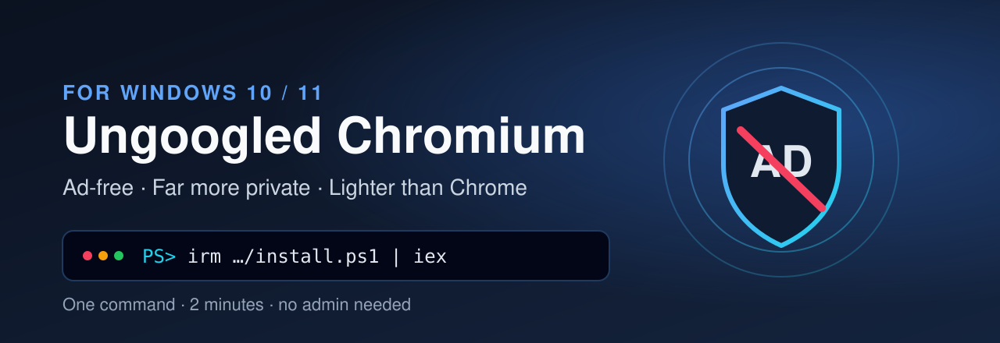

<p align="center">
  
</p>

<p align="center">
  <a href="#install-in-2-minutes"></a>
  
  
  <a href="LICENSE"></a>
</p>

<h3 align="center">Chrome's speed. None of the ads. Nothing sent to Google.</h3>

<p align="center">
  <b>No YouTube ads</b> · <b>63% less CPU at start-up</b> · <b>30% less RAM</b> · <b>0 background calls to Google</b>
</p>

---

## Install in 2 minutes

**1.** Press **Start**, type **PowerShell**, and open it.<br>
**2.** Paste this line and press **Enter**:

```powershell
irm https://raw.githubusercontent.com/uniqueabhishek/ungoogled-chromium-adfree-private-lightweight-setup/main/install.ps1 | iex
```

**3.** Coming from Chrome? Answer **Y** when it asks, and your bookmarks, history, tabs and (optionally) passwords come along ([details](#moving-from-google-chrome)).<br>
**4.** Click three buttons in the browser it opens ([see below](#after-the-script-three-clicks)). Done.

> 🔍 **Never run a script you can't read.** [install.ps1](install.ps1) is short and commented line by line. Nothing is hidden, nothing is downloaded except the official browser and its open-source add-ons, and [uninstall.ps1](#undo) reverses all of it.

---

## Chrome vs this setup

Measured on the same laptop, fresh profiles, 4 rounds ([full report](benchmark/REPORT.md)):

| | Google Chrome | **This setup** |
|---|---|---|
| ⚡ CPU burned in the first 30 s | 12.9 CPU-seconds | **4.7** — 63% less |
| 🚀 Start-up, cold / warm | 2.2 s / 1.5 s | **1.2 s / 1.0 s** |
| 🧠 Peak RAM, 8 real websites open | 4.2 GB | **2.9 GB** |
| 📡 Background traffic, 3 min idle | 54 requests to 18 Google servers | **0 requests, 0 bytes** |
| 📺 Ads on YouTube and websites | Yes | **None** |

---

## What you get

| | Feature | How |
|---|---|---|
| 🚫 | **No ads, YouTube included** | uBlock Origin Lite in its strongest "Complete" mode, plus extra lists for ads, cookie banners and pop-ups |
| 🛡️ | **Trackers blocked before they load** | AdGuard's free encrypted DNS, inside the browser only |
| 🔒 | **Nothing sent to Google in the background** | Ungoogled Chromium itself: no sign-in, sync, Safe Browsing calls or "phone home" traffic |
| 🔎 | **Google search with live suggestions** | Ungoogled Chromium ships with no search engine; this adds Google as the default |
| 🧩 | **Chrome Web Store works** | The Chromium Web Store helper brings back "Add to Chromium" and extension updates |
| 📦 | **Your Chrome profiles come along** | Bookmarks, history, open tabs, shortcuts and profile names, each profile with Google search; saved passwords through a guided export and import |
| 🔄 | **Updates itself** | A scheduled task updates the browser every Wednesday and at every sign-in |
| 🔐 | **HTTPS first, faster loads** | Typed addresses try `https://` first; likely pages are preloaded |

---

## After the script: three clicks

The script opens the browser with two tabs. Browsers do not allow these three steps to be scripted:

1. **uBlock Origin Lite tab:** click **Add extension**.
2. **Extensions tab:** turn on **Developer mode** (top right) → click **Load unpacked** → click the folder bar at the top of the window → press **Ctrl + V** (the script copied the folder path for you) → **Enter** → **Select Folder**. This adds the Chromium Web Store helper.
3. **Pin uBlock Origin Lite:** click the puzzle icon in the toolbar → pin it.

**Recommended:** `chrome://extensions` → uBlock Origin Lite → **Details** → turn on **Allow User Scripts** (better blocking on YouTube) and **Allow in Incognito**.

**Check it works:** open YouTube or any site that had ads and press **Ctrl + Shift + R**. Type `weather` in the address bar — Google suggestions appear as you type.

---

## Updates

- **The browser updates itself.** A scheduled task called *Update Ungoogled Chromium* runs every Wednesday at 1 pm and at every Windows sign-in. New versions reach winget a day or two after their official release.
- **Settings survive updates.** An update only replaces the browser program; your settings, extensions and profiles stay.
- **Extensions update through Chromium Web Store.** It shows a badge when an update is ready.
- **Update right now:** `winget upgrade --id eloston.ungoogled-chromium -e`

---

## Good to know

- **"Managed by your organization"** appears in the browser menu. That is because of the settings this script applies (search suggestions, HTTPS-first, uBlock settings). Nobody else controls your browser. See them at `chrome://policy`.
- **A site breaks?** Click the uBlock icon and lower the slider to **Basic** for that site. If a site does not load at all, turn off **Use secure DNS** at `chrome://settings/security` to check whether AdGuard DNS is the cause.
- **Netflix, Prime Video and other DRM video do not play.** They need Google's Widevine component, which Ungoogled Chromium leaves out. Use another browser for those.
- **No Google sign-in or sync in the browser.** Signing in to Gmail, YouTube or Drive *websites* works normally. For passwords, use a password manager such as Bitwarden.
- **Two honest trade-offs versus Chrome:** there is no Google Safe Browsing (the red "Dangerous site" warning), though uBlock's malware lists and AdGuard DNS block many known bad sites; and security updates arrive a few days to a couple of weeks after Chrome's. Be careful with unknown links and attachments.
- **Classic uBlock Origin no longer works** in any Chromium-based browser (Manifest V2 was removed). uBlock Origin Lite plus AdGuard DNS gets close to the same result.
- **Windows PowerShell says scripts are disabled?** The one-line command above is not affected by that setting. If you downloaded the files instead, run `powershell -ExecutionPolicy Bypass -File .\install.ps1`.

---

## Moving from Google Chrome?

**The install command asks you** when it finds Google Chrome on the PC: answer **Y** and it brings your Chrome profiles over in the same run. To do it later instead, close **both** browsers and paste this into PowerShell:

```powershell
irm https://raw.githubusercontent.com/uniqueabhishek/ungoogled-chromium-adfree-private-lightweight-setup/main/import-chrome.ps1 | iex
```

- **Brings across every Chrome profile:** bookmarks, history, address-bar suggestions, open tabs, new tab shortcuts and the profile name. Each profile gets Google search.
- **Saved passwords too, if you want:** it asks, then opens Chrome's **Export passwords** page and Ungoogled Chromium's **Import passwords** page for you, and deletes the exported file afterwards. Also consider a password manager such as Bitwarden, since this browser has no sync ([guide](docs/GUIDE.md#9-passwords-with-bitwarden)).
- **Does not bring:** website logins (Chrome locks them; sign in once per site) or extensions (add them again from the Chrome Web Store).
- **Safe:** Chrome is never changed, and anything replaced in Ungoogled Chromium is kept in `User Data\Backup before import <date>`.
- **Extensions are per profile:** in each extra profile, add uBlock Origin Lite once with the link the script prints at the end.

---

## Already using Ungoogled Chromium?

Running the script is safe: it backs up every browser file it changes as `<file>.before-setup-<date>`. It sets everything except the search engine of **existing** profiles (the Google default applies to profiles created from now on). To switch existing profiles too, use [extras/Set-Search-Engine.ps1](extras/Set-Search-Engine.ps1) — it needs PowerShell 7, [uv](https://docs.astral.sh/uv/) and [Node.js](https://nodejs.org/).

## Extras

In [extras/](extras/), all for PowerShell 7 (`pwsh`):

| Script | What it does |
|---|---|
| `Set-Search-Engine.ps1` | Google as the default in **every existing** profile, plus the shortcuts `yt cats`, `gh react`, `maps london` |
| `Edit-Shortcuts.ps1` | Adds or removes new tab page shortcut tiles (the "Add shortcut" button is hidden in Ungoogled Chromium) |

The full step-by-step manual, including moving passwords over and troubleshooting, is in [docs/GUIDE.md](docs/GUIDE.md).

---

## Undo

```powershell
irm https://raw.githubusercontent.com/uniqueabhishek/ungoogled-chromium-adfree-private-lightweight-setup/main/uninstall.ps1 | iex
```

Removes the policies, the update task, the Google default for new profiles, AdGuard DNS and the extension flag. Your profiles, bookmarks and extensions stay. To remove the browser as well: `winget uninstall --id eloston.ungoogled-chromium`.

---

## Credits

This repo only sets things up; the real work is by these projects:

- [ungoogled-chromium](https://github.com/ungoogled-software/ungoogled-chromium) — the browser
- [uBlock Origin Lite](https://github.com/uBlockOrigin/uBOL-home) — the ad blocker
- [Chromium Web Store](https://github.com/NeverDecaf/chromium-web-store) — Web Store installs and extension updates
- [AdGuard DNS](https://adguard-dns.io/) — the ad-blocking DNS

Not affiliated with any of them, or with Google. Licensed under [MIT](LICENSE).
